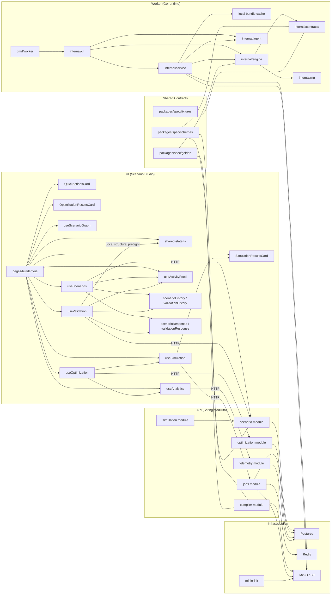
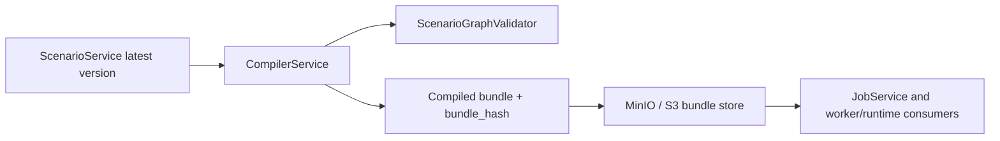
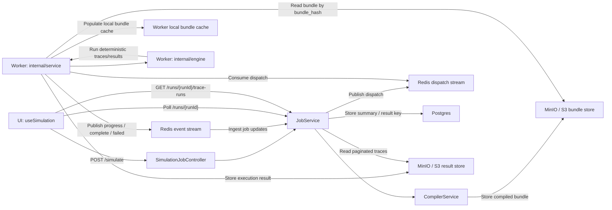
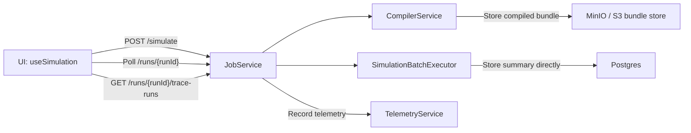
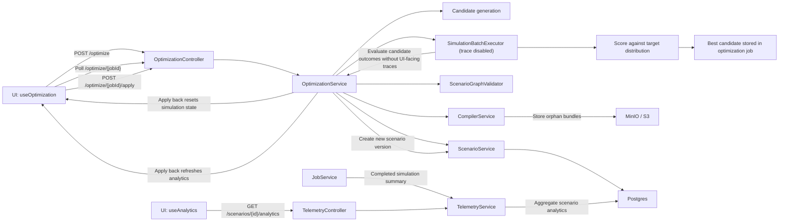

# Athanor Knowledge Graph

This artifact shows how the Scenario Studio UI, Spring Modulith API, Go worker, shared contracts, and local infrastructure fit together.
Use it for onboarding and for tracing how scenarios move from authoring to validation, compilation, simulation, optimization, and analytics.
The UI surface is split across authoring controls plus result cards for simulation and optimization, all backed by shared studio state, activity feed entries, and local history snapshots.

## How To Read This

Read the structural view first, then the runtime sections.
The structural view shows ownership boundaries; the runtime sections show request, job, bundle, event, trace, and telemetry flows.

The authoritative graph source lives in `docs/architecture/knowledge-graph.dot`.

## View / Render

You can view the knowledge graph in two ways:

1. Read the Mermaid diagrams in this Markdown file directly.
2. Render the Graphviz source in `docs/architecture/knowledge-graph.dot`.
3. Open the standalone searchable viewer in `docs/architecture/knowledge-graph.html`.

From the repository root, generate an SVG with:

```bash
dot -Tsvg docs/architecture/knowledge-graph.dot -o /tmp/athanor-knowledge-graph.svg
```

Generate a PNG instead with:

```bash
dot -Tpng docs/architecture/knowledge-graph.dot -o /tmp/athanor-knowledge-graph.png
```

If `dot` is not installed, install Graphviz first, then rerun the command.

## Searchable Viewer

The searchable viewer is generated from the DOT source and committed as repo artifacts:

- `docs/architecture/knowledge-graph-data.json`
- `docs/architecture/knowledge-graph.html`

Regenerate both artifacts from the repository root with:

```bash
node scripts/generate-knowledge-graph-viewer.mjs
```

Open the generated HTML file directly in a browser:

```bash
open docs/architecture/knowledge-graph.html
```

The viewer embeds the graph data for direct `file://` use and keeps a JSON fetch fallback for hosted or copied artifacts.

## Legend

- `HTTP`: synchronous request/response edge
- `Internal`: in-process module/service call
- `Async`: queue or event-stream handoff
- `Store`: persistent write
- `Read`: persistent or object-store read
- `Poll`: UI status or trace polling

## Structural Architecture



## Async Simulation Runtime

### Compilation Handoff





### Local Simulation Fallback

The API also exposes a synchronous simulation entry point at `POST /scenarios/{id}/simulate`.
When remote dispatch is disabled, the async job path stays inside the API after compilation and uses the local executor instead of Redis/worker dispatch.



## Optimization And Telemetry



## Notes

- The UI uses the async simulation job path (`POST /simulate`) as its primary execution flow.
- The local simulation fallback stays on the `JobService` path after bundle compilation when remote dispatch is disabled, then stores the summary directly and records telemetry.
- Flow A updates shared studio state, the authoring-result surface, the activity feed, and scenario local history.
- Flow B updates the validation-result surface, the activity feed, and validation local history.
- Flow F generates candidates, scores them against the target distribution, persists the best candidate in the optimization job, and resets simulation state plus analytics after apply-back.
- `packages/spec` defines the canonical contract boundary, while the live runtime still uses concrete in-repo model shapes and compiled payload conventions.
