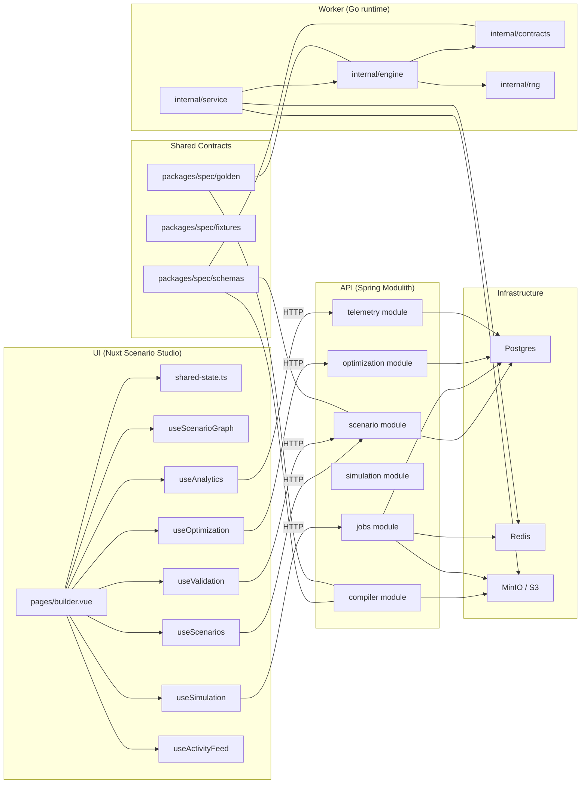

# Athanor Knowledge Graph

## How To Read This

This document has three graph sections:

- A structural architecture view that shows ownership boundaries.
- A runtime view that shows how requests, jobs, bundles, worker events, traces, and analytics move through the system.

The authoritative graph source lives in `docs/architecture/knowledge-graph.dot`.

## Legend

- `HTTP`: synchronous request/response edge
- `Internal`: in-process module/service call
- `Async`: queue or event-stream handoff
- `Store`: persistent write
- `Read`: persistent or object-store read
- `Poll`: UI status or trace polling

## System Overview

## Async Simulation Runtime

## Optimization And Analytics

## Notes

- The UI uses the async simulation job path (`POST /simulate`) as its primary execution flow.
- The API also exposes a synchronous simulation endpoint (`POST /scenarios/{id}/simulate`) as an alternate path.
- `packages/spec` defines the canonical contract boundary, while the live runtime still uses concrete in-repo model shapes and compiled payload conventions.
