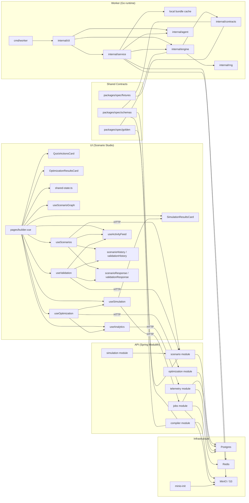
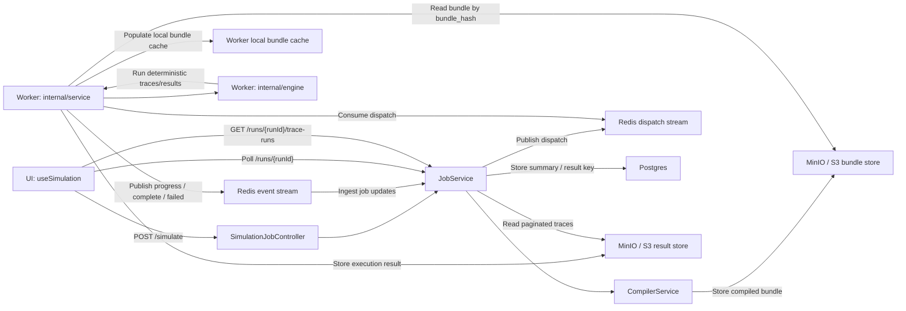
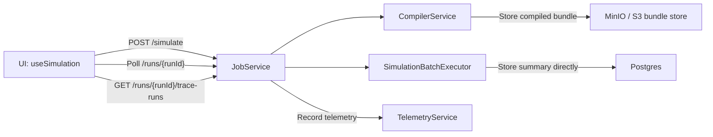
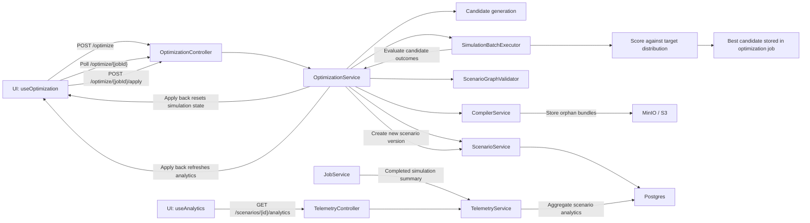

# Athanor Knowledge Graph

This artifact shows how the Scenario Studio UI, Spring Modulith API, Go worker, shared contracts, and local infrastructure fit together.
Use it for onboarding and for tracing how scenarios move from authoring to validation, compilation, simulation, optimization, and analytics.
The UI surface is split across authoring controls plus result cards for simulation and optimization, all backed by shared studio state, activity feed entries, and local history snapshots.

## How To Read This

Read the structural view first, then the runtime sections.
The structural view shows ownership boundaries; the runtime sections show request, job, bundle, event, trace, and telemetry flows.

The authoritative graph source lives in `docs/architecture/knowledge-graph.dot`.

## Legend

- `HTTP`: synchronous request/response edge
- `Internal`: in-process module/service call
- `Async`: queue or event-stream handoff
- `Store`: persistent write
- `Read`: persistent or object-store read
- `Poll`: UI status or trace polling

## Structural Architecture

## Async Simulation Runtime

### Local Simulation Fallback

## Optimization And Telemetry

## Notes

- The UI uses the async simulation job path (`POST /simulate`) as its primary execution flow.
- The local simulation fallback stays on the `JobService` path after bundle compilation when remote dispatch is disabled, then stores the summary directly and records telemetry.
- Flow A updates shared studio state, the authoring-result surface, the activity feed, and scenario local history.
- Flow B updates the validation-result surface, the activity feed, and validation local history.
- Flow F generates candidates, scores them against the target distribution, persists the best candidate in the optimization job, and resets simulation state plus analytics after apply-back.
- `packages/spec` defines the canonical contract boundary, while the live runtime still uses concrete in-repo model shapes and compiled payload conventions.
